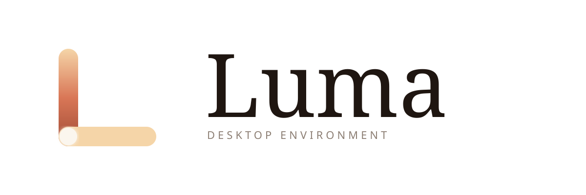

  

# Luma

Um ambiente de desktop para Linux, escrito em Rust.

Luma é um Desktop Environment completo construído sobre Wayland, com
compositor próprio, taskbar, menu de aplicativos e sistema de temas.
O foco é unir três coisas que raramente andam juntas: um visual
caprichado, configurabilidade de verdade e acessibilidade pensada
desde o primeiro dia.

> Status: em desenvolvimento ativo, rumo à versão 1.0.

---

## O que é

Luma não é um tema nem uma extensão de outro desktop. É um ambiente
gráfico inteiro, feito do zero:

- **Compositor Wayland** próprio, construído com Smithay
- **Taskbar** estilo KDE, com seis zonas (launcher, workspaces, apps,
  bandeja do sistema, relógio e mostrar área de trabalho)
- **Menu de aplicativos** em tela cheia, com busca, favoritos e atalhos
- **Decoração de janelas** com sombra suave e botões próprios
- **Sistema de temas** completo, controlado por um único arquivo de
  configuração

Tudo isso com uma identidade visual chamada Golden Hour: tons de café,
coral, mel e sálvia, a paleta de um fim de tarde.

---

## Por que existe

A maioria dos ambientes de desktop trata acessibilidade como um menu
de ajustes escondido, adicionado no fim. Luma faz o caminho inverso.

Luma é desenhado por uma pessoa com deficiência física, e a
acessibilidade é uma decisão de arquitetura, não um recurso opcional.
Alvos de clique generosos, navegação completa por teclado, contraste
adequado e um futuro preset de acessibilidade extrema fazem parte do
projeto desde o início.

A meta é simples: um desktop que seja bonito para todo mundo e
utilizável de verdade por todo mundo.

---

## Identidade de design

Luma mistura referências de forma proposital:

- O menu lembra a clareza do menu clássico do Windows 7
- A configurabilidade segue a filosofia do Linux Mint e do KDE
- A base técnica em Rust se inspira na arquitetura do COSMIC
- A acessibilidade guia cada decisão de interface
- O visual Golden Hour dá a alma: café, coral, mel e sálvia

Layout tradicional, ergonomia familiar, tecnologia moderna.

---

## Estado atual

Já funciona:

- Compositor Wayland rodando aplicativos GTK e KDE/Qt
- Taskbar completa com bandeja do sistema lendo dados reais
  (bateria, rede, bluetooth, volume)
- Menu de aplicativos em tela cheia
- Workspaces
- Decoração de janelas
- Sistema de temas via arquivo de configuração

Em construção: notificações, applets clicáveis, aplicativos nativos
e os presets visuais alternativos.

---

## Documentação

- [Documentação técnica](docs/TECHNICAL.pt.md) — arquitetura, build,
  como contribuir
- [Visão e roadmap](docs/ROADMAP.pt.md) — para onde o Luma vai
- [English version](README.en.md)

---

## Licença

GPL-3.0-or-later.
